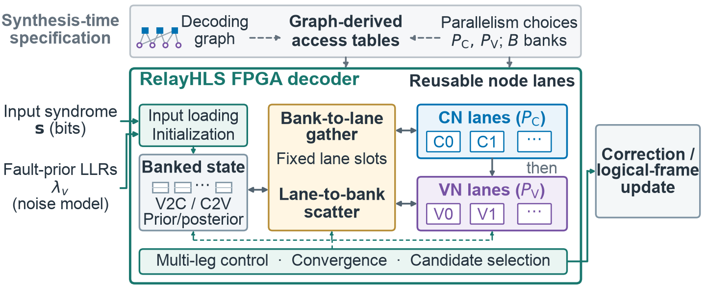

# RelayHLS

RelayHLS is a parameterized FPGA implementation of Relay belief propagation
(Relay-BP) for quantum LDPC decoding. Reusable check-node (CN) and variable-node
(VN) lanes process complete neighborhoods through banked message memories,
graph-derived access tables, and fixed-destination gathers. A fixed-point,
multi-leg controller supports convergence checks, prior-weighted candidate
selection, and correction-related outputs.



## Released configurations

This release contains the actual validated source, generated constants, 32 ordered
inputs and golden outputs for:

- **BB72:** all nine configurations, C1/C2/C4 × V2/V4/V8.
  C1/C2 use 64 edge-message banks; C4 uses 128.
- **BB144:** **C4V8 with 128 banks only**, the highest-throughput validated BB144
  configuration. This is a selection among validated results, not a claim of
  global optimality.

Each configuration has its own snapshot in [`benchmarks/`](benchmarks).
[`release_manifest.json`](release_manifest.json) binds those files to the
validated snapshots. Synthesizable source and constants retain their exact
validated hashes. The testbench input pathname is the only portability edit.

## Results

| Workload | Configuration | Banks | Mean RTL latency (µs) | Service rate (decodings/s) | LUT | BRAM18 equivalent |
|---|---|---:|---:|---:|---:|---:|
| BB72 | C4V8 | 128 | 220.65 | 4,512.58 | 176,779 | 701 |
| BB144 | C4V8 | 128 | 1,054.39 | 940.38 | 191,026 | 3,717 |

Both complete CN and VN group loops achieve **II = 1** in all ten released
configurations. Each passed ordinary RTL co-simulation with 32 cases and 160
output-field comparisons, followed by placement and routing for the VCU118
`xcvu9p-flga2104-2L-e` at 100 MHz.

The matched BB72 comparison gives C4V8 latency speedups of **4.09×** over an AMD
EPYC 9554 single-thread SIMD implementation and **1.16×** over an NVIDIA L40S
GPU with resident inputs. FPGA vectorless post-route analysis estimates
**951.8 decodings/J**, or **201.9×** the measured CPU-package efficiency and
**23.5×** the measured GPU-device efficiency. These use different component
energy boundaries: the FPGA value is an on-chip estimate; CPU/GPU values are
package/device counter measurements. See [evaluation scope](docs/evaluation.md).

## Validation data

- [Evaluation workbook](data/RelayHLS_Evaluation.xlsx)
- [BB72 nine-point results](data/bb72/matrix.csv) and [routed resources](data/bb72/resource_utilization.csv)
- [BB144 C4V8 result](data/bb144/matrix.csv)
- [Per-case RTL timing](data/RTL_per_case_timing.csv): 320 latencies and 310 service intervals
- [Complete-group HLS schedules](data/HLS_schedules.csv)
- Aggregate [BB72](data/bb72/validation) and [BB144](data/bb144/validation) validation evidence
- [CPU/GPU timing and energy trials](data/cpu_gpu)
- [Machine-readable evaluation](data/evaluation.json) and [data dictionary](data/README.md)

RTL cycle counts and routed timing/resources are not physical board performance
measurements. The released fixtures establish implementation equivalence for
the ordered inputs, not a logical-error-rate or end-to-end QEC demonstration.

## Quick start

Check the release without any FPGA tools or network access:

```bash
python3 scripts/verify_release.py
python3 -m unittest discover -s tests -p 'test_*.py'
```

Reproduce one native fixture using an installed AMD arbitrary-precision header set:

```bash
python3 scripts/run_native.py bb72 c4v8 --include /path/to/Vitis/include
```

Run synthesis explicitly with Vitis HLS 2025.2:

```bash
RELAYHLS_WORKLOAD=bb144 RELAYHLS_POINT=c4v8 RELAYHLS_STAGE=synthesis \
  vitis-run --mode hls --tcl scripts/run_hls.tcl
```

The native and vendor commands create a fresh `build/` directory and start new
work. An optional [CI template](docs/ci/verify-release.yml) runs the offline checks.
See [reproduction instructions](docs/reproducibility.md)
for C simulation, ordinary RTL co-simulation, routing and their verification gates.

## Design and adaptation

The source includes 4-bit message magnitudes, four decoding legs, at most 40
updates, convergence checks every two updates, and at most two candidates.
Lane and bank counts are synthesis-time choices. The released `config.json`
files record the generated configurations; editing them does not regenerate
the headers. A new graph or configuration requires consistent graph constants,
bank schedules, and CN/VN lookup tables plus fresh validation.

[Architecture and interface](docs/architecture.md) explain the datapath and fixture
boundaries. [Source provenance](docs/provenance.md) documents the exact snapshots,
portable testbench edit, and the retained CPU/GPU benchmark sources.

## Citation and license

Use [`CITATION.cff`](CITATION.cff) to cite this repository. Source and released
validation data are distributed under the [MIT License](LICENSE). AMD tools,
device libraries, and third-party software retain their own licenses and are not
bundled. Earlier synthetic fixtures remain available in Git history.
